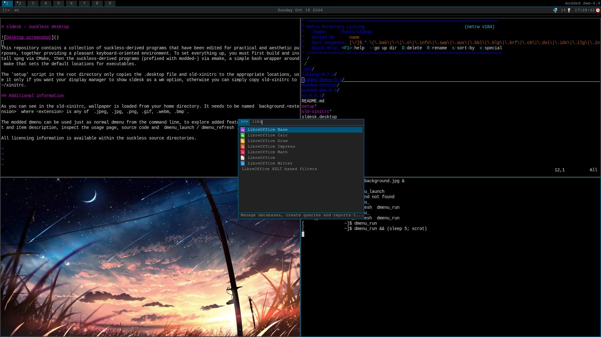

# sldesk - suckless desktop

This repository contains a collection of suckless-derived programs that have been edited for practical and aesthetic purposes, together providing a pleasant keyboard-oriented environment. To set everything up, you must first build and install spng via CMake, then the suckless-derived programs (prefixed with modded-) via emake, a simple bash wrapper around make that sets the default locations for executables.

The 'setup' script in the root directory only copies the .desktop file and sld-xinitrc to the appropriate locations, use it only if you want your display manager to show sldesk as a wm option, otherwise you can simply copy sld-xinitrc to ~/xinitrc.

## Additional information

As you can see in the sld-xinitrc, wallpaper is loaded from your home directory. It needs to be named `background.<extension>` where <extension> is any of `.jpeg, .jpg, .png, .gif, .webm, .bmp`.

The modded dmenu can be used just as normal dmenu from the command line, to explore added features such as image support and item description, inspect the usage page, source code and `dmenu_launch`/`dmenu_refresh`.

All licencing information is available within the suckless source directories.

